# Keyring

**Зашифрованные хранилища паролей, секретов и документов внутри Obsidian.**

Keyring превращает обычные папки хранилища Obsidian в зашифрованные сейфы: у каждой папки свой мастер-пароль, данные на диске всегда зашифрованы, а синхронизация через Syncthing (или любой другой файловый синк) работает без дополнительных настроек. Плагин работает на десктопе и в мобильном Obsidian.

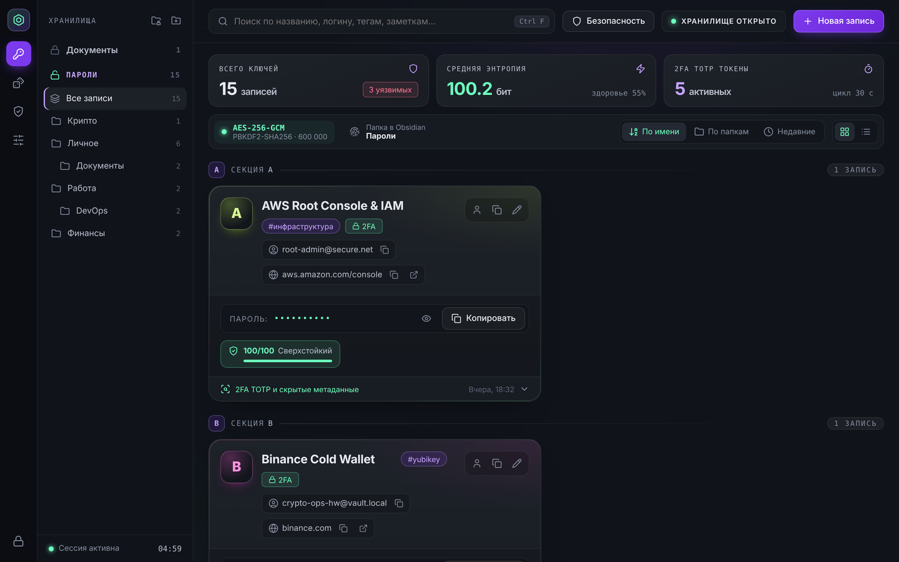

---

## Содержание

- [Ключевые возможности](#ключевые-возможности)
- [Безопасность](#безопасность)
- [Установка](#установка)
- [Быстрый старт](#быстрый-старт)
- [Несколько хранилищ и шифрование папок](#несколько-хранилищ-и-шифрование-папок)
- [Работа с записями](#работа-с-записями)
- [Ключ восстановления](#ключ-восстановления)
- [Копии заголовков хранилищ](#копии-заголовков-хранилищ)
- [Экспорт и импорт](#экспорт-и-импорт)
- [Синхронизация между устройствами](#синхронизация-между-устройствами)
- [Мобильная версия](#мобильная-версия)
- [Настройки](#настройки)
- [Команды](#команды)
- [Формат данных](#формат-данных)
- [Ограничения](#ограничения)
- [Вопросы и ответы](#вопросы-и-ответы)
- [Структура проекта](#структура-проекта)

---

## Ключевые возможности

- **Шифрование AES-256-GCM.** Ключ выводится из мастер-пароля через PBKDF2-SHA256 (600 000 итераций). Используется только встроенный WebCrypto, без сторонних криптобиблиотек.
- **Любое число независимых хранилищ.** «Пароли», «Документы», «Работа»… — каждое со своим мастер-паролем. Открытие одного не открывает остальные.
- **Шифрование любой папки целиком.** Вместе с подпапками: заметки становятся записями, а PDF, сканы и изображения — зашифрованными вложениями. Открытые исходники удаляются только после проверки.
- **Ключ восстановления.** Запасной вход, если мастер-пароль забыт. Пара ключей ECDH P-256, закрытый ключ хранится у вас.
- **Ограничение попыток.** После 3 неверных паролей ввод блокируется на 5 минут.
- **Автоблокировка и очистка буфера обмена.** Хранилище блокируется по таймеру бездействия и при сворачивании приложения. Скопированный секрет стирается из буфера.
- **Записи четырёх типов:** логины, секреты и API-ключи, защищённые заметки, файлы-вложения.
- **Удобство менеджера паролей:**
  - копирование любого поля в один клик;
  - коды 2FA (TOTP);
  - генератор паролей и оценка стойкости;
  - история версий пароля;
  - заметки в Markdown с `[[wikilinks]]`.
- **Анализ хранилища:** слабые, повторяющиеся и устаревшие пароли, логины без 2FA, конфликты синхронизации.
- **Подсказки.** Keyring находит логины и пароли, записанные в заметках обычным текстом, и предлагает перенести их в поля.
- **Синхронизация без конфликтов на всё хранилище.** Одна запись — один файл, поэтому конфликт затрагивает только одну запись.
- **Десктопный и мобильный интерфейс.** Карточки или список, группировка, поиск, нижняя навигация на телефоне.

---

## Безопасность

### Что защищено

| Данные | Как хранятся |
|---|---|
| Записи (логины, пароли, заметки, поля, вложения, история) | Файлы `*.kr`, AES-256-GCM, уникальный IV на каждое сохранение |
| Названия записей, сайты, теги | Внутри зашифрованных файлов — снаружи не видны |
| Имена файлов записей | Случайные идентификаторы, ничего не раскрывают |
| Ключ данных хранилища | В `keyring.vault.json`, зашифрован ключом из мастер-пароля. Три копии заголовка с автовосстановлением |
| Мастер-пароль | **Нигде не хранится** |
| Закрытый ключ восстановления | Только у владельца — вне Obsidian |

Без шифрования остаются только названия подпапок-категорий (например, `Работа/DevOps`), имя хранилища и количество записей.

### Схема шифрования

```
мастер-пароль ──PBKDF2-SHA256 (соль 128 бит, 600 000 итераций)──▶ KEK
ключ данных DEK (256 бит, случайный) ──AES-256-GCM(KEK)──▶ keyring.vault.json
каждая запись ──AES-256-GCM(DEK, IV 96 бит, AAD = id записи)──▶ <id>.kr
```

- **Отдельный ключ данных.** Смена мастер-пароля перешифровывает только DEK, записи не трогаются.
- **AAD = id записи.** Шифротекст привязан к записи: подмена одного файла другим обнаруживается.
- **Проверка пароля.** Неверный пароль не проходит проверку целостности AES-GCM. Хэш пароля для сверки не хранится.
- **Ключ в памяти.** Пока хранилище открыто, ключ данных хранится в памяти как `CryptoKey`. Его байты извлекаются только на мгновение — чтобы защитить открытое хранилище новым ключом восстановления без повторного ввода пароля. Промежуточные буферы с ключевым материалом затираются.
- **Расшифрованные данные не пишутся на диск.** Исключения — явные действия пользователя: «Сохранить копию» и «Расшифровать обратно».
- **Защита заголовка.** Допустимое число итераций в заголовке ограничено (от 100 тыс. до 5 млн). Подменённый заголовок не может ни ослабить защиту, ни «повесить» устройство.

### Защита сессии

- **Автоблокировка** через заданное время бездействия (по умолчанию 5 минут).
- **Блокировка при сворачивании** окна Obsidian или уходе мобильного приложения в фон.
- **Ручная блокировка** — кнопка, `Ctrl/Cmd + L` или клик по индикатору в строке состояния.
- **Буфер обмена.** Скопированный секрет стирается через 30 секунд, если в буфере всё ещё он.
- **Лимит попыток.** После 3 неверных паролей ввод блокируется на 5 минут. Ограничение действует везде, где спрашивается мастер-пароль. Вход ключом восстановления доступен всегда и сбрасывает счётчик.
- **Иконки сайтов по умолчанию выключены,** чтобы внешний сервис не видел адреса ваших сайтов.

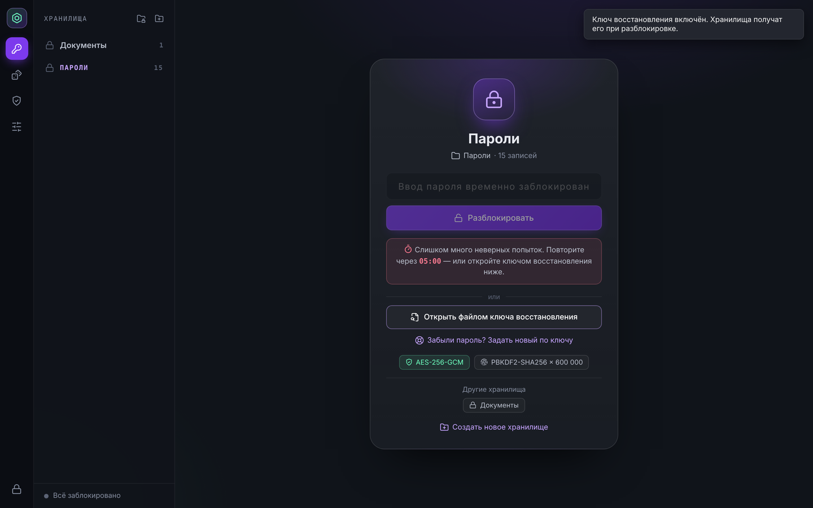

### Модель угроз

**Keyring защищает:**
- от чтения данных по скопированным файлам — флешка, облако, бэкап, папка Syncthing на чужом устройстве;
- от подбора пароля «с экрана» на оставленном без присмотра устройстве (лимит попыток, автоблокировка);
- от утечки через буфер обмена и случайной синхронизации расшифрованных данных.

**Keyring не защищает:**
- от вредоносного ПО и сторонних плагинов Obsidian, пока хранилище открыто. Плагины работают в одном окружении и теоретически имеют доступ к памяти и интерфейсу;
- от слабого мастер-пароля. Офлайн-перебор ограничен только стоимостью PBKDF2;
- от потери мастер-пароля, если не создан ключ восстановления.

> Независимого аудита безопасности не проводилось. Для самых критичных учётных записей разумно дополнительно использовать специализированный менеджер паролей.

---

## Установка

Сборка не требуется.

1. Скопируйте папку `keyring` в `<хранилище>/.obsidian/plugins/keyring/`:
   ```
   keyring/
     main.js
     manifest.json
     styles.css
     src/            (необязательно — модули уже встроены в main.js)
   ```
2. Откройте **Настройки → Сторонние плагины** и включите **Keyring**.
3. Откройте Keyring через иконку ключа на боковой панели или командой **«Keyring: Открыть Keyring»**.

Все модули встроены в `main.js`, поэтому достаточно трёх файлов: `main.js`, `manifest.json`, `styles.css`. Для обновления замените их — папка `src/` рядом, если осталась, не используется (для разработки создайте пустой файл `src/.dev`, тогда модули читаются из `src/`).

Минимальная версия Obsidian — 1.4.0.

---

## Быстрый старт

1. **Создайте хранилище.** Нажмите «Создать хранилище», выберите папку (например, `Пароли`) и задайте мастер-пароль.
2. **Создайте ключ восстановления.** Откройте **Настройки → Восстановление доступа** и сохраните файл ключа вне Obsidian.
3. **Добавьте записи** кнопкой **«Новая запись»** или зашифруйте существующую папку с заметками через **«Зашифровать папку…»**.

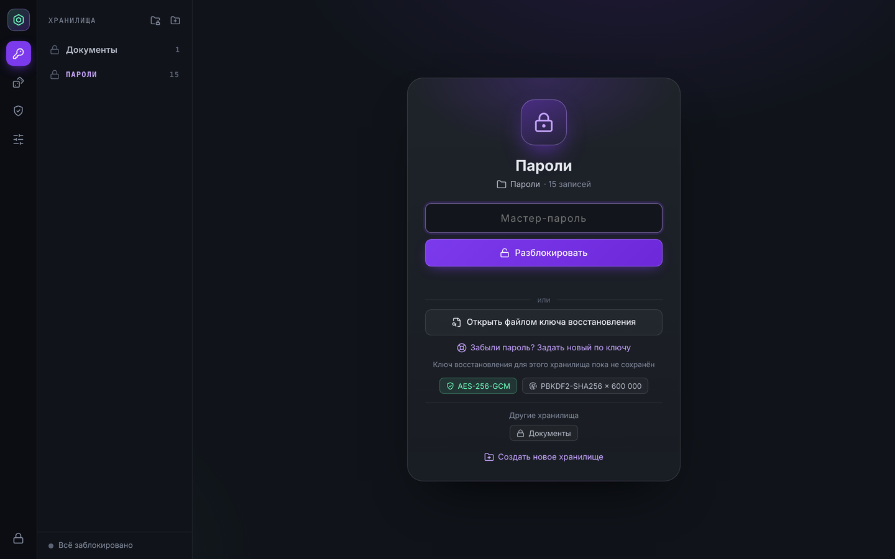

---

## Несколько хранилищ и шифрование папок

### Хранилище — это папка

Любая папка Obsidian может стать хранилищем Keyring. В ней появляется заголовок `keyring.vault.json` и зашифрованные файлы записей. Подпапки становятся категориями.

```
Пароли/                       ← хранилище «Пароли» (свой мастер-пароль)
  keyring.vault.json
  keyring.vault.backup.json
  Работа/DevOps/3f9a…c1.kr
  Финансы/a01b…77.kr
Документы/                    ← хранилище «Документы» (другой мастер-пароль)
  keyring.vault.json
  Паспорт/…kr
Заметки/                      ← обычные незашифрованные заметки
```

- **Сколько угодно хранилищ.** У каждого свой мастер-пароль и свой ключ данных.
- **Хранилища независимы.** Открытие одного не даёт доступа к другим, разблокированы могут быть сразу несколько.
- **Вложенность запрещена.** Хранилища не могут находиться одно внутри другого.
- **Поиск хранилищ.** Keyring находит их автоматически по `keyring.vault.json` (или его резервной копии), в том числе созданные на другом устройстве.
- **Переключение** — в левой панели на десктопе и через кнопку со щитом на телефоне.

### Убрать или удалить хранилище

**«Убрать это хранилище…»** — на экране блокировки, или крестик в «Настройки» → «Все хранилища»:
- **в папке нет записей** (остался только заголовок) — хранилище удаляется: заголовок, его копии и пустая папка;
- **записи есть** — хранилище скрывается из Keyring, файлы остаются на месте. Вернуть: «Настройки» → «Скрытые хранилища»;
- **папку удалили в Obsidian** — хранилище пропадает из списка само и не восстанавливается.

Остальные хранилища это не затрагивает.

### Зашифровать папку (рекурсивно)

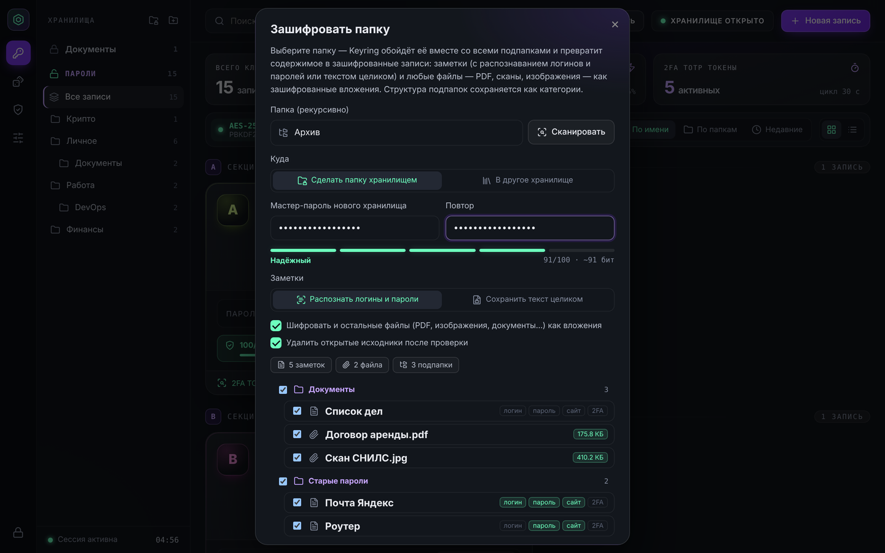

Как запустить:
- правый клик по папке в проводнике → **«Keyring: зашифровать папку…»**;
- команда **«Зашифровать папку (рекурсивно)…»**;
- кнопка в панели хранилищ или в настройках.

**Что происходит:**
1. Выбранная папка обходится вместе со всеми подпапками. Перед шифрованием показывается дерево файлов с флажками.
2. Есть два варианта, куда поместить данные:
   - **«Сделать папку хранилищем»** — данные остаются на месте, но шифруются под новым мастер-паролем;
   - **«В другое хранилище»** — данные переносятся в существующий сейф, в категорию с именем папки.
3. Заметки обрабатываются на выбор:
   - **распознать** строки «Логин: …», «Пароль: …», «Сайт: …», «2FA: …» в тексте заметки и разложить их по полям;
   - **сохранить текст целиком** как защищённую заметку.
4. Остальные файлы (PDF, JPG, DOCX и т.д.) шифруются как вложения — до 25 МБ на файл.
5. Каждая запись после шифрования проверяется обратной расшифровкой. Только после этого удаляется открытый исходник (можно отключить).

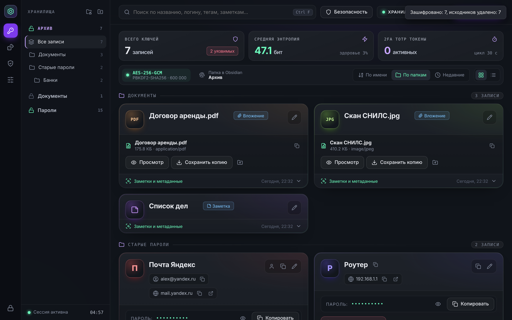

**Работа с вложениями:**
- **«Просмотр»** — изображения, PDF и текст открываются в памяти, без записи на диск;
- **«Сохранить копию»** — расшифрованный файл через диалог загрузки;
- **«Расшифровать обратно»** — восстановить открытый файл на прежнем месте в Obsidian.

> Старые открытые копии могут оставаться вне Keyring: в версиях Syncthing (`.stversions`), резервных копиях и корзине ОС. Ссылки `![[вложение]]` из других заметок на зашифрованные файлы перестают работать.

---

## Работа с записями

### Типы записей

| Тип | Назначение |
|---|---|
| **Логин** | Сайт, логин, пароль, 2FA, дополнительные поля, заметки |
| **Секрет / API** | Ключи и токены, пароли Wi-Fi, идентификаторы |
| **Заметка** | Защищённый текст в Markdown и поля (номера документов, кодовые слова) |
| **Файл** | Зашифрованное вложение до 25 МБ |

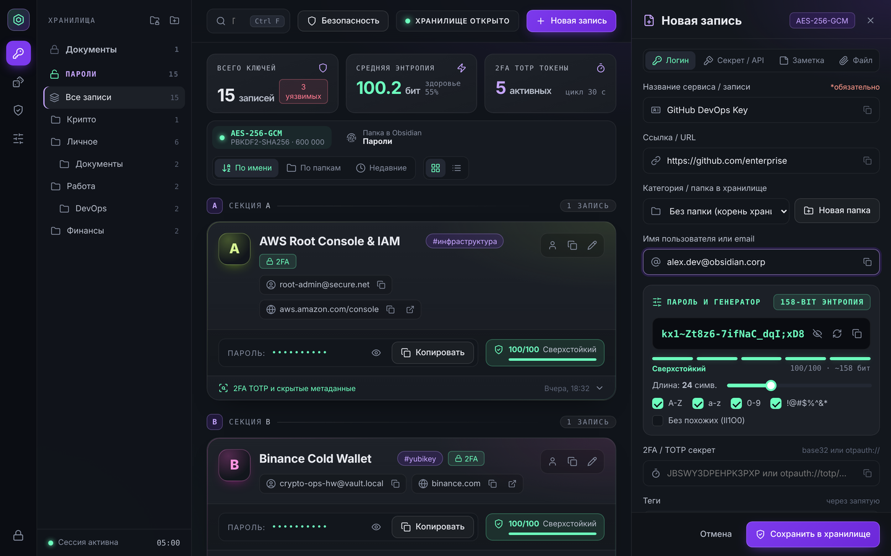

### Редактор

- **Генератор пароля:** длина, наборы символов, исключение похожих символов, шкала стойкости.
- **2FA (TOTP):** поле принимает base32 или ссылку `otpauth://` и сразу показывает текущий код.
- **Дополнительные поля:** у каждого можно включить скрытие значения.
- **Категория:** выбор подпапки хранилища или создание новой.
- **Копирование:** у каждого поля ввода есть кнопка копирования.

### Карточки и список

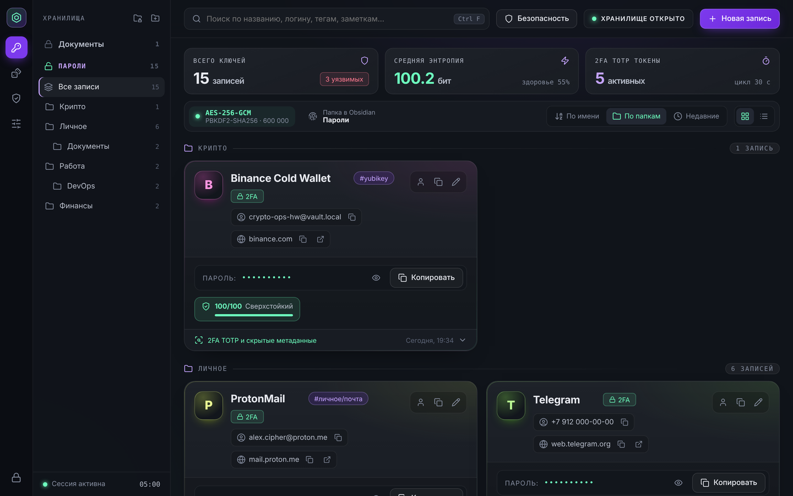

- **Карточки.**
  - Клик по свободному месту раскрывает или сворачивает карточку.
  - В раскрытой карточке видны заметки, поля, живой код 2FA, метаданные и история версий.
  - Группы (по имени, по папкам, по дате) идут заголовками на всю ширину.
- **Список.**
  - Компактная таблица.
  - Группы сворачиваются и по умолчанию свёрнуты.
  - Клик по строке открывает запись в окне: секреты скрыты до нажатия, длинные значения и заметки свёрнуты.
- **Вид запоминается.** Открывается Keyring всегда на «Все записи».
- **Поиск** (`Ctrl/Cmd + F`) — по названию, логину, сайту, тегам, заметкам и открытым полям.
- **Копирование** любого поля в один клик: название, логин, пароль, ссылка, код и секрет 2FA, поля, заметки целиком, имя файла, метаданные.

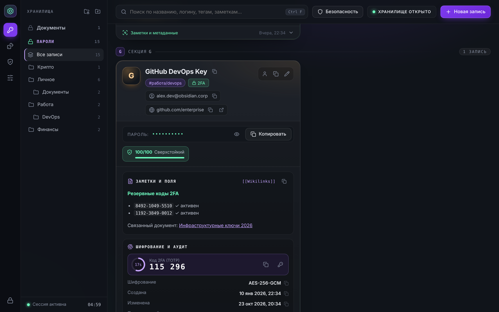

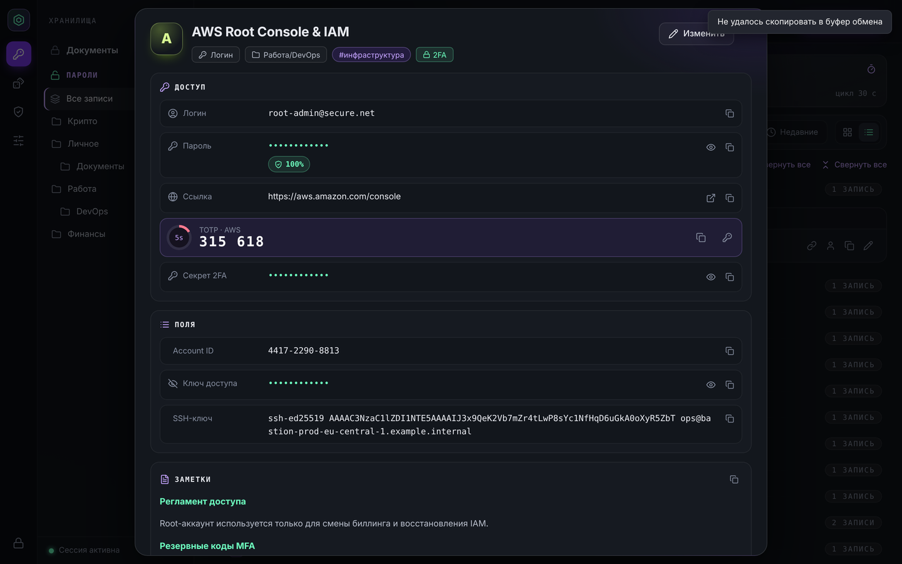

### История версий

При смене пароля прежнее значение сохраняется внутри записи в зашифрованном виде (по умолчанию до 10 версий). Его можно посмотреть, скопировать или восстановить.

### Данные для входа в тексте заметок

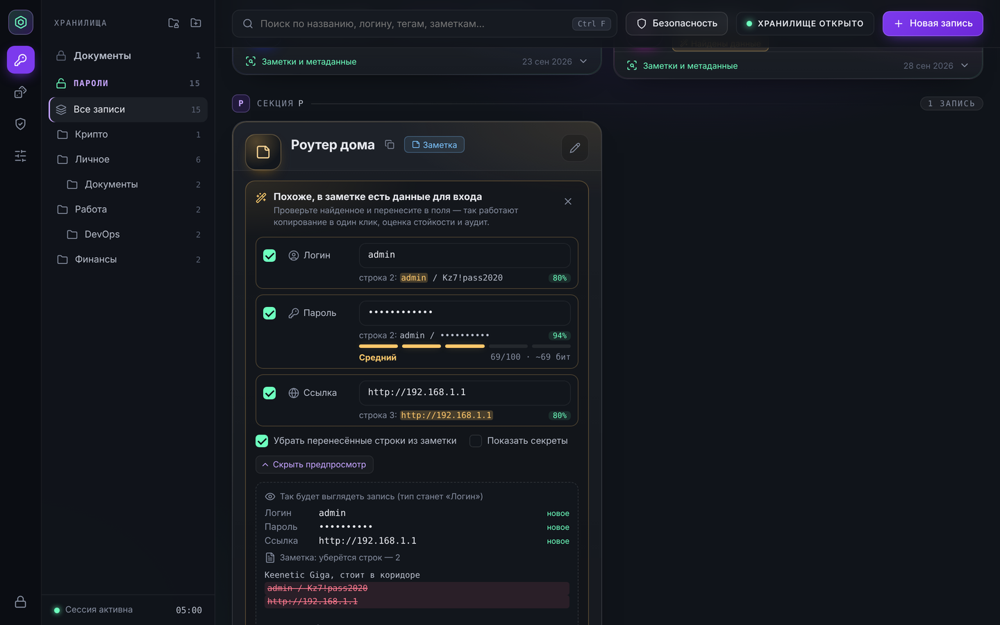

Если логин и пароль записаны в заметке обычным текстом — `admin / Kz7!pass2020`, «пароль от него Sunny#2019», голая ссылка, e-mail или секрет 2FA, — карточка помечается значком **«Найдены данные»**. В раскрытой карточке появляется панель с найденными значениями.

- **Каждое значение:** строка-источник с подсветкой, уверенность распознавания, возможность выбрать другой вариант или поправить вручную.
- **Предпросмотр** итоговой записи и строк, которые уберутся из заметки.
- **Действия:**
  - **«Перенести в поля»** — сохраняет запись;
  - **«Открыть в редакторе»** — открывает редактор с уже подставленными значениями;
  - **«Больше не предлагать»**.

- **Запись «в столбик».** Логин или e-mail на одной строке и пароль на следующей распознаются, в том числе если каждое значение лежит в отдельном блоке кода.
- **Свойства заметки (frontmatter).** Из них берутся только теги — при шифровании папки и в подсказке. Логины и пароли ищутся только в основном тексте; сами свойства сохраняются в заметке без изменений.

Подсказка заполняет только пустые поля. Распознавание выполняется локально.

### Анализ хранилища

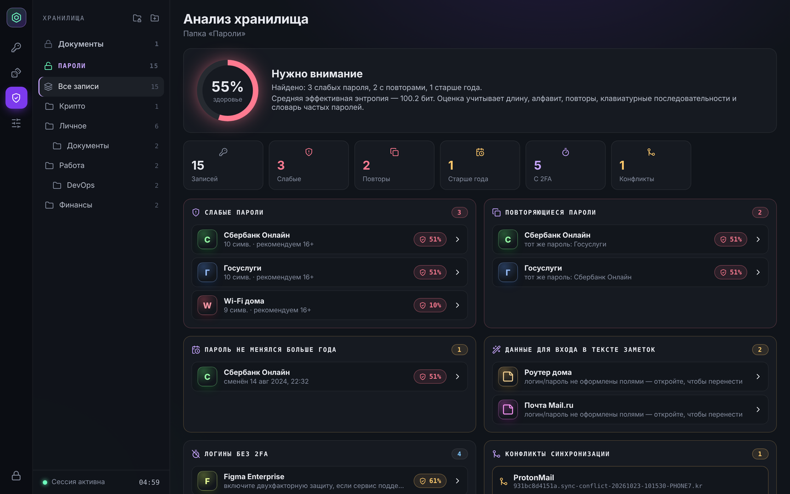

- **Индекс «здоровья» хранилища** и средняя эффективная энтропия паролей.
- **Проблемы:**
  - слабые пароли;
  - повторяющиеся пароли;
  - пароли, не менявшиеся больше года;
  - логины без 2FA;
  - данные для входа в тексте заметок.
- **Конфликты синхронизации.** Видно, какие поля различаются; можно оставить текущую версию или взять версию из копии.

### Генератор

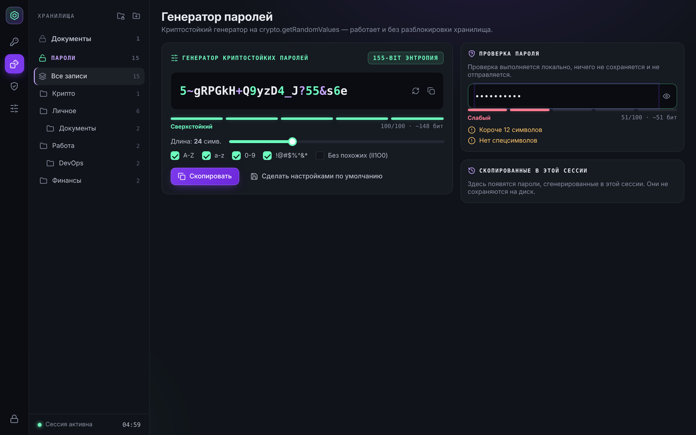

- **Генерация** на `crypto.getRandomValues` без смещения распределения.
- **Работает без разблокировки** хранилища.
- **Проверка любого пароля** выполняется локально.

---

## Ключ восстановления

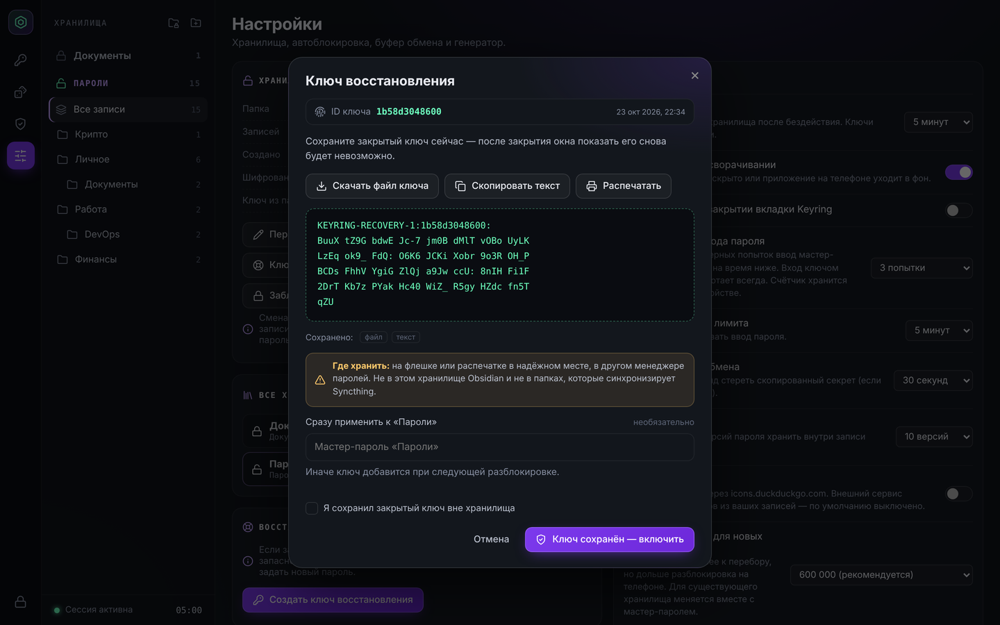

Ключ восстановления позволяет открыть хранилища, если мастер-пароль забыт.

**Как это устроено:**
- **Пара ключей ECDH P-256.** Открытый ключ хранится в настройках плагина и «запечатывает» ключ данных каждого хранилища (ECDH → HKDF-SHA256 → AES-256-GCM).
- **Закрытый ключ** показывается один раз. Его можно скачать файлом `keyring-recovery-<ID>.key`, скопировать текстом или распечатать. Keyring его не хранит.
- **Файл ключа** — обычный текст: первая строка `KEYRING-RECOVERY-1:…` и есть ключ, ниже — пояснение. В комплекте восстановления под ним добавлены копии заголовков хранилищ.
- **Какие хранилища защищаются.** Открытые — сразу при создании ключа, новые — при создании, закрытые — при следующей разблокировке паролем (или кнопкой «Добавить сейчас» с вводом пароля).

**Вход и восстановление.** На экране блокировки есть кнопка **«Открыть файлом ключа восстановления»**. Принимается файл любого формата: `.key`, JSON ключа из прежних версий, `.txt`, заметка, текст с распечатки — ключ находится внутри автоматически. Затем выберите действие:
- **«Только открыть»** — хранилище откроется на сессию, мастер-пароль не изменится;
- **«Открыть и сменить пароль»** — задать новый мастер-пароль.

Вход ключом работает и во время блокировки после неверных попыток.

**Если ключ «не найден в этом хранилище».** Окно объясняет причину и показывает, какие ключи есть в хранилище:
- **ключ заменён новым** — нужен файл текущего ключа;
- **текущий ключ, но хранилище его ещё не получило** — оно не открывалось паролем после создания ключа или создано на другом устройстве с другим ключом;
- **ключ с другого устройства** — хранилище им не защищено.

Комплект восстановления помогает и здесь: если в нём есть копия заголовка с этим ключом, Keyring откроет хранилище по ней, проверит на записях папки и снова добавит ключ в хранилище. После входа ключом в хранилище также добавляется текущий ключ из настроек, если его там не было.

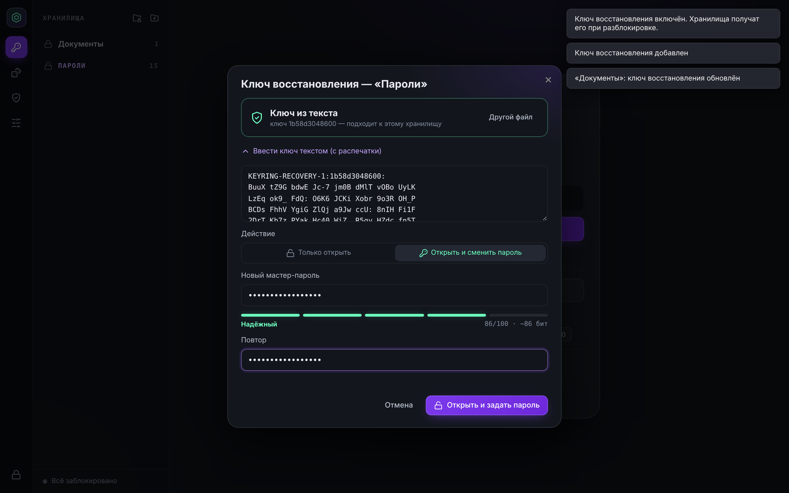

**Комплект восстановления.** После сохранения ключа Keyring предлагает скачать комплект: тот же ключ плюс копии заголовков уже защищённых хранилищ. С ним хранилище открывается, даже если `keyring.vault.json` и все его копии утеряны. Комплект заменяет обычный файл ключа и принимается везде, где принимается ключ.

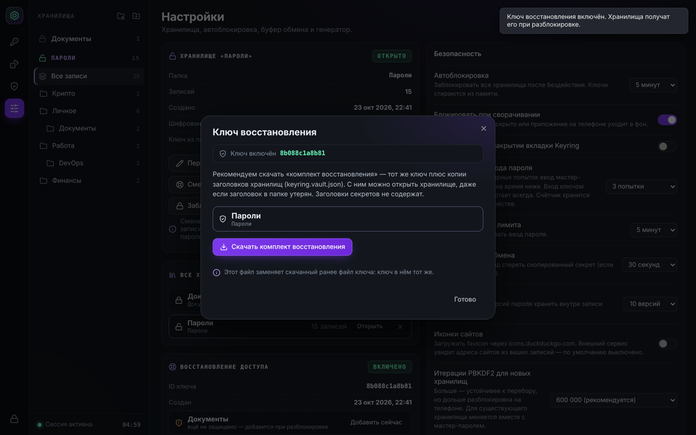

**Смена ключа.** В открытом хранилище: **«Безопасность» → «Сменить ключ восстановления (новый файл)»**.
- Новый ключ сразу заменяет старый в текущем хранилище.
- В остальных хранилищах замена происходит при их разблокировке.
- Старый файл перестаёт открывать хранилища.

> Закрытый ключ открывает **все** защищённые им хранилища. Храните его на флешке, распечатке или в другом менеджере паролей — не в хранилище Obsidian и не в синхронизируемых папках.

---

## Копии заголовков хранилищ

В `keyring.vault.json` лежит зашифрованный ключ данных хранилища — без него записи не открыть ни паролем, ни ключом восстановления. Секретов заголовок не содержит, поэтому Keyring держит его в трёх местах:

| Копия | Где |
|---|---|
| Основной файл | `<папка>/keyring.vault.json` |
| Резервная копия рядом | `<папка>/keyring.vault.backup.json` |
| Копия вне папки | Настройки плагина (`data.json`) |

- **Автовосстановление.** Если основной файл удалён или повреждён, Keyring берёт самую свежую исправную копию, восстанавливает файл и сообщает об этом.
- **Копии всегда актуальны.** Обновляются при каждом изменении заголовка: смене пароля, ключа восстановления, итераций.
- **Хранилище без заголовка.** Если пропали все копии, папка с файлами `*.kr` появляется в **«Настройки» → «Копии заголовков»**. Кнопка **«Восстановить заголовок из файла…»** принимает комплект восстановления, файл экспорта или старую копию `keyring.vault.json` в любом формате.
- **Экспорт.** **«Скачать копию заголовков»** сохраняет заголовки всех хранилищ одним файлом. Храните его вместе с ключом восстановления.

---

## Экспорт и импорт

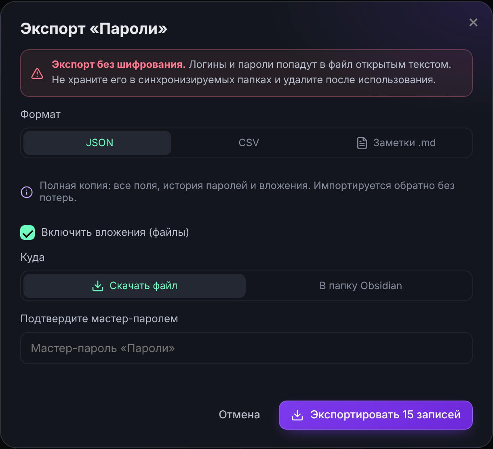

**«Безопасность» → «Экспорт…»** (или «Настройки» → кнопка «Экспорт…» в открытом хранилище). Перед экспортом нужно ввести мастер-пароль.

| Формат | Что внутри | Импорт обратно |
|---|---|---|
| **JSON** | Полная копия: все поля, теги, папки, история паролей, вложения (по желанию) | Без потерь |
| **CSV** | Таблица: `title, username, password, url, totp, notes, tags, folder, type, fields, favorite, created, updated`. Открывается в Excel | Да, без вложений и истории |
| **Markdown — один файл** | Все записи одним документом с разделами по папкам: заголовок, поля, заметки, история паролей. Без вложений | Да, без вложений |
| **Markdown — заметка на запись** | Свойства (теги, тип, ссылка, даты), заголовок, поля, вложение рядом, заметки, история паролей. Подпапки повторяют категории | Без потерь — импорт из папки Obsidian |

- Выгрузить можно всё хранилище или текущую папку.
- В Markdown служебные метки (`<!-- keyring:… -->`) спрятаны в комментариях — в режиме чтения их не видно, а импорт по ним восстанавливает записи точно.
- Файл скачивается или сохраняется в папку `Keyring export <дата>` в корне Obsidian (на телефоне — по умолчанию).
- **Экспорт не зашифрован.** Не держите его в синхронизируемых папках и удалите после использования.

**«Безопасность» → «Импорт (JSON, CSV, .md)…»** принимает один или несколько файлов сразу, а также папку Obsidian с заметками:
- экспорт Keyring (JSON, CSV, Markdown одним файлом или папка «заметка на запись» — вместе с вложениями);
- обычные заметки `.md`: логин, пароль, сайт и 2FA берутся из строк вида «Логин: …», теги — из свойств заметки;
- Bitwarden (JSON и CSV), Chrome / Edge, 1Password, KeePass / KeePassXC, LastPass — по названиям колонок, разделитель `,` `;` или табуляция определяется сам. Незнакомые колонки сохраняются как дополнительные поля.

Перед импортом видно, сколько записей будет добавлено. Совпадающие (по ID или по названию + логину + ссылке) можно пропустить, обновить или добавить копией; все записи можно положить в отдельную папку. Импортированные записи сразу шифруются.

---

## Синхронизация между устройствами

- **Что синхронизируется.** Только зашифрованные файлы (`keyring.vault.json`, `keyring.vault.backup.json`, `*.kr`). Мастер-пароль не синхронизируется и вводится на каждом устройстве.
- **Изменения с других устройств** подхватываются автоматически: открытое хранилище перечитывается.
- **Конфликты.** Если одна запись изменена на двух устройствах одновременно, Syncthing создаёт копию `…sync-conflict-….kr`. Она разбирается во вкладке «Анализ».
- **Если основной файл записи пропал, а конфликтная копия осталась**, запись всё равно показывается в списке, а над списком появляется кнопка **«Восстановить»** — копии снова становятся обычными записями.
- **Удалённые записи.** «Анализ» → «Удалённые записи» → «Найти удалённые записи» ищет файлы этого хранилища в версиях Syncthing (`.stversions`) и корзине Obsidian (`.trash`) и возвращает их. Включите в Syncthing версионирование файлов (File Versioning) для папки с Obsidian — тогда удаление на одном устройстве можно откатить.
- **Удаление папки хранилища на одном устройстве** Syncthing повторяет на всех остальных.
- **Смена мастер-пароля** на одном устройстве применяется везде после синхронизации `keyring.vault.json`.
- **Настройки плагина** (`data.json`) секретов не содержат.
- **Счётчик неверных попыток** хранится локально на каждом устройстве.

---

## Мобильная версия

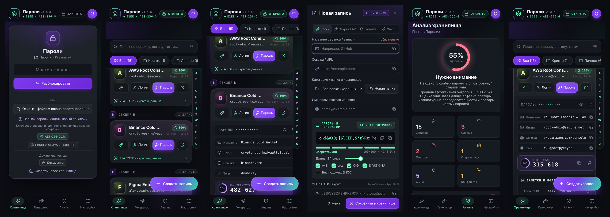

- **Компактный интерфейс:**
  - шапка со статусом;
  - поиск и чипы категорий;
  - алфавитный указатель;
  - кнопка «Создать запись»;
  - нижняя навигация: Хранилище · Генератор · Анализ · Настройки.
- **Виды:** карточки с кнопками «Логин» и «Пароль» или компактный список с окном записи.
- **Поддержка edge-to-edge экранов.** Интерфейс не уходит под статус-бар и встаёт над нижней панелью Obsidian. Отступы можно задать вручную.
- **Клавиатура.** Форма разблокировки не «прыгает» при её открытии, нижнее меню на это время скрывается.
- **Блокировка** при уходе приложения в фон.
- **Планшет.** Кнопка вида переключает полный интерфейс (как на компьютере) и компактный (как на телефоне): в полном — значок телефона в верхней панели, в компактном — значок монитора в шапке и пункт в меню фильтров. Выбор запоминается; то же — «Настройки» → «Вид интерфейса».

---

## Настройки

| Настройка | По умолчанию |
|---|---|
| Автоблокировка | 5 минут |
| Блокировать при сворачивании | Включено |
| Блокировать при закрытии вкладки Keyring | Выключено |
| Лимит попыток ввода пароля | 3 попытки |
| Блокировка после лимита | 5 минут |
| Очистка буфера обмена | 30 секунд |
| История паролей | 10 версий |
| Иконки сайтов (через DuckDuckGo) | Выключено |
| Итерации PBKDF2 для новых хранилищ | 600 000 |
| Вид интерфейса (полный / компактный) | Авто |
| Отступ сверху / снизу на телефоне | Авто |
| Генератор по умолчанию | 24 символа, все наборы |

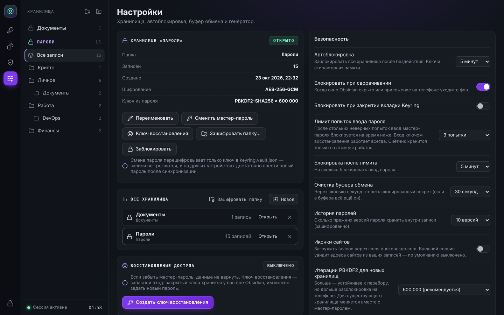

**В открытом хранилище** — кнопка **«Безопасность»** (на телефоне — кнопка со щитом):
- смена мастер-пароля;
- создание или смена ключа восстановления;
- блокировка.

---

## Команды

| Команда | Описание |
|---|---|
| Открыть Keyring | Открывает вкладку Keyring |
| Новая запись | Открывает редактор новой записи |
| Зашифровать папку (рекурсивно)… | Также доступно в контекстном меню папки |
| Заблокировать все хранилища | `Ctrl/Cmd + L` внутри Keyring |
| Сгенерировать пароль и скопировать | Без открытия интерфейса |

---

## Формат данных

**Заголовок хранилища** — `keyring.vault.json`:

```json
{
  "format": "obsidian-keyring",
  "version": 1,
  "cipher": "AES-256-GCM",
  "name": "Пароли",
  "kdf": { "name": "PBKDF2", "hash": "SHA-256", "iterations": 600000, "salt": "…" },
  "key": { "iv": "…", "data": "…" },
  "recovery": [{ "keyId": "…", "alg": "ECDH-P256+HKDF-SHA256+A256GCM", "epk": {…}, "salt": "…", "iv": "…", "data": "…" }]
}
```

`keyring.vault.backup.json` — точная копия заголовка. Поле `savedAt` помогает выбрать самую свежую копию при восстановлении.

**Запись** — `<категория>/<id>.kr`:

```json
{ "keyring": 1, "id": "3f9a…c1", "iv": "…", "data": "…" }
```

Внутри `data` — JSON записи: тип, название, логин, пароль, ссылка, TOTP, теги, поля, заметки, история, вложение, даты.

---

## Ограничения

- **Хранилище целиком в памяти.** При разблокировке расшифровываются все записи. Keyring рассчитан на пароли, секреты и документы, а не на гигабайты файлов.
- **Вложения** — до 25 МБ на файл.
- **Биометрия.** Разблокировка по отпечатку или Face ID недоступна: Obsidian не даёт плагинам доступа к биометрии. Можно включить системную блокировку приложения Obsidian по отпечатку.
- **Загрузка на телефоне.** «Сохранить копию» может не сработать в мобильном приложении — используйте «Расшифровать обратно».
- **Названия подпапок-категорий** видны в проводнике и в файловой системе.

---

## Вопросы и ответы

**Где хранится мастер-пароль?**
Нигде. При разблокировке из него вычисляется ключ, которым расшифровывается ключ данных хранилища. Неверный пароль просто не проходит проверку целостности.

**Что будет, если забыть мастер-пароль?**
Без ключа восстановления данные расшифровать невозможно. С ключом — откройте хранилище файлом ключа и задайте новый пароль.

**Можно ли использовать разные пароли для разных папок?**
Да. Каждое хранилище — отдельная папка со своим мастер-паролем. Папки шифруются независимо.

**Видят ли другие устройства мои пароли?**
На другие устройства попадают только зашифрованные файлы. Открыть их можно, только зная мастер-пароль или имея ключ восстановления.

**Что будет, если удалить или потерять `keyring.vault.json`?**
Keyring восстановит его сам — из `keyring.vault.backup.json` в той же папке или из копии в настройках плагина. Если пропали все копии, восстановите заголовок из комплекта восстановления или файла экспорта: «Настройки» → «Копии заголовков» → «Восстановить заголовок из файла…». Без единой копии заголовка записи расшифровать невозможно — ни паролем, ни ключом восстановления.

**Можно ли вернуть данные в открытый вид?**
Да: «Расшифровать обратно» у вложений и записей, «Сохранить копию» у файлов. Отдельные значения всегда можно скопировать.

---

## Структура проекта

```
main.js                  загрузчик и встроенная копия модулей (src/ — при наличии src/.dev)
manifest.json
styles.css
src/
  plugin.js              ядро: настройки, команды, события, меню папки, строка состояния
  constants.js
  crypto/                codec · cipher (AES-GCM, PBKDF2, ключ восстановления) · generator · strength · totp
  vault/                 vault · manager · header-store · exchange · lockout · entry · importer · converter · detector · audit
  ui/                    view · nav · lock-screen · vault-page · card · editor · entry-modal
                         suggest-panel · generator-page · analysis · settings-page · settings-tab
                         modals · convert-modal · recovery · widgets
  util/                  dom · format · clipboard · emitter · suggest · recovery-key
docs/                    скриншоты
```
